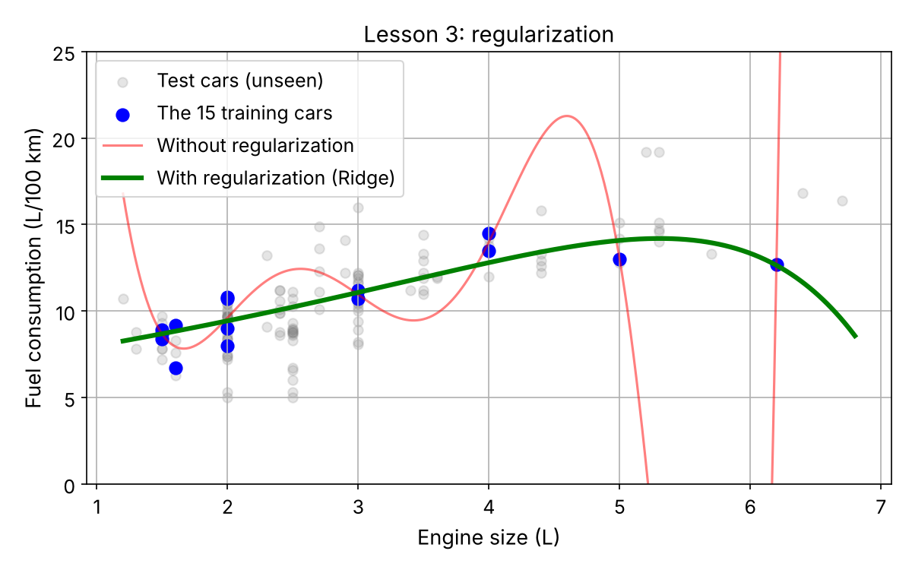

# Machine Learning Fundamentals: Two Regression Projects

Two beginner-friendly regression projects covering the core ideas of Chapter 1 (*The Machine Learning Landscape*) of *Hands-On Machine Learning with Scikit-Learn, Keras & TensorFlow* (3rd ed., Aurélien Géron).

| Project | Question | Data | Best test MAE |
|---|---|---|---|
| [Car fuel consumption](car-fuel-consumption-prediction/) | How much fuel (L/100 km) does a new car need, given its engine size? | 613 car models of 2026 + 2015–2024 history, Natural Resources Canada | 1.18 L/100 km (k-NN) |
| [Life satisfaction](life-satisfaction-prediction/) | Does a country's GDP per capita predict its people's life satisfaction? | OECD Better Life Index + World Bank GDP, 2020 | – (walkthrough of the book's example) |



## Concepts covered

- Supervised learning and regression
- Model-based learning (Linear Regression) vs. instance-based learning (k-Nearest Neighbors)
- Training set vs. test set, Mean Absolute Error
- Non-representative training data
- Overfitting and regularization (Ridge)

## Repository structure

```
├── car-fuel-consumption-prediction/   # Project 1: own question and dataset
│   ├── fuel_consumption_prediction.ipynb
│   ├── data/
│   └── images/
├── life-satisfaction-prediction/      # Project 2: walkthrough of the book's example
│   ├── life_satisfaction_prediction.ipynb
│   └── images/
├── requirements.txt                   # shared Python packages
└── README.md
```

## Setup

```bash
git clone https://github.com/AT3060/car-fuel-consumption-prediction---life-satisfaction-prediction.git
cd car-fuel-consumption-prediction---life-satisfaction-prediction
pip install -r requirements.txt
jupyter notebook
```

## Tools

Python · pandas · NumPy · Matplotlib · Scikit-Learn · Jupyter
