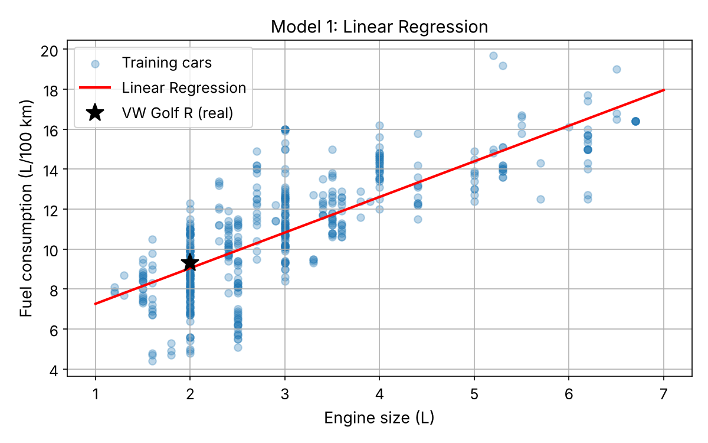

# Car Fuel Consumption Prediction

**Project 1 of 2** in this repository · Python · Scikit-Learn · Regression

Predicting how much fuel a new car uses (**L/100 km**) from its engine size, using official data on all 613 car models of model year 2026.


---

## 🎯 Goal

Fuel consumption is one of the most important numbers for car buyers, fleet managers and regulators, but it is only known after a car has been tested. This project asks:

> **How well can we estimate a car's fuel consumption from a single, easy-to-know property — its engine size?**

At the same time, the project is a hands-on study of the fundamental ideas of Machine Learning (Chapter 1 of *Hands-On Machine Learning*, Géron), tested on real, current data instead of a textbook example:

1. Can a simple model learn a useful relationship from data?
2. How do two different *types* of learning algorithms compare?
3. What goes wrong when the training data is not representative, when a model overfits — and how can regularization help?

## 📊 Data

| | |
|---|---|
| **Source** | Natural Resources Canada — official Fuel Consumption Ratings ([Open Data portal](https://open.canada.ca/data/en/dataset/98f1a129-f628-4ce4-b24d-6f16bf24dd64)) |
| **Main dataset** | Model year 2026: 613 car models, 15 columns (updated Oct 2026) |
| **Extra dataset** | Model years 2015–2024: 10,060 car models (for the trend analysis) |
| **Feature used** | Engine size (L) |
| **Target** | Combined fuel consumption (L/100 km) = 55 % city + 45 % highway |
| **Licence** | Open Government Licence – Canada |

## 🛠️ Approach

1. **Exploration:** statistics, most/least efficient cars, fuel types, and the 10-year trend (2015–2026)
2. **Train/test split:** 80 % of the cars for training (490), 20 % hidden for an honest final test (123)
3. **Two models:**
   - **Linear Regression** — *model-based*: learns a straight line (2 parameters)
   - **k-Nearest Neighbors (k = 5)** — *instance-based*: averages the 5 most similar training cars
4. **Evaluation** on unseen cars with the **Mean Absolute Error (MAE)**
5. **Three experiments** on core ML concepts (see below)

## ✅ Results — what was achieved

| Model | Test MAE (L/100 km) |
|---|---|
| Linear Regression | **1.30** |
| k-Nearest Neighbors (k = 5) | **1.18** |

- Using **only engine size**, both models predict a car's consumption to within about **1.2–1.3 L/100 km** on average — for cars they have never seen (typical range: 4.4 to 19.7 L/100 km).
- The linear model learned an interpretable rule: **every extra litre of engine size adds about 1.8 L/100 km**.
- Example: for the **VW Golf R** (2.0 L, not in the training data), the model predicted **9.0 L/100 km** — the real value is **9.3**.



## 🔬 Three experiments

### 1. Non-representative training data → the hybrid problem
A model trained **without hybrid cars** was tested on the 37 hybrids.

| Tested on | MAE (L/100 km) |
|---|---|
| Normal cars (similar to training data) | 1.30 |
| Hybrid cars (never seen) | **2.57** |

It overestimates hybrids by about 2.5 L/100 km — **twice its normal error**. A model only knows what its training data shows; new technology breaks it.


### 2. Overfitting
A very flexible model (polynomial of degree 10) trained on only **15 cars**:

| | MAE (L/100 km) |
|---|---|
| On its 15 training cars | 0.60 — looks excellent |
| On unseen test cars | **9.22** — useless |

The curve memorizes the noise of the few training points and makes wild predictions in between.


### 3. Regularization fixes it
Same 15 cars, same degree-10 features, but with **Ridge regularization** (α = 1):

| | Without regularization | With Ridge |
|---|---|---|
| Training MAE | 0.60 | 0.77 |
| **Test MAE** | 9.22 | **1.42** |

Slightly worse on the training data, but **6.5× better on new cars** — the model generalizes.


### Bonus: 10-year trend
The average consumption of new car models stayed almost flat at about **11 L/100 km from 2015 to 2024**. The 2026 file shows a lower value, but it contains fewer models (613 vs. ~1,000 per year), so this must be interpreted with care.

## 💡 Key findings

- Engine size alone explains a large part of fuel consumption, but not all of it: weight, body type and especially **hybrid technology** matter a lot.
- A model's quality must always be measured on **data it has not seen** — training error alone can be completely misleading (0.60 vs. 9.22).
- Simpler or regularized models often **generalize better** than complex ones, especially with little data.

## ⚠️ Limitations

- Only one feature is used, on purpose, to keep the concepts clear.
- Hybrids are detected by the word "Hybrid" in the model name — a few may be missed.
- Lab-test values (Canadian test cycle) differ from real-world consumption.

## 🔜 Possible next steps

- Use more features (cylinders, vehicle class, transmission, fuel type) → expected to reduce the error clearly
- Tune `k` and `alpha` systematically with cross-validation (covered in Chapter 2 of the book)
- Predict CO₂ emissions (g/km) instead of fuel consumption

## ▶️ How to run

```bash
git clone https://github.com/AT3060/car-fuel-consumption-prediction---life-satisfaction-prediction.git
cd car-fuel-consumption-prediction---life-satisfaction-prediction
pip install -r requirements.txt
cd car-fuel-consumption-prediction
jupyter notebook fuel_consumption_prediction.ipynb
```

The notebook downloads the newest data from the official website and uses the local copy in `data/` if no connection is available.

## 📁 Folder contents

```
car-fuel-consumption-prediction/
├── fuel_consumption_prediction.ipynb   # the full project, step by step with explanations
├── data/                               # local copy of the official CSV files + SOURCE.md
└── images/                             # plots generated by the notebook
```

## Credits

- Concepts follow Chapter 1 of *Hands-On Machine Learning with Scikit-Learn, Keras & TensorFlow* (3rd ed.) by Aurélien Géron, O'Reilly. The question, dataset, code and experiments in this project are my own.
- Data: Natural Resources Canada, *Fuel consumption ratings*, Open Government Licence – Canada.
