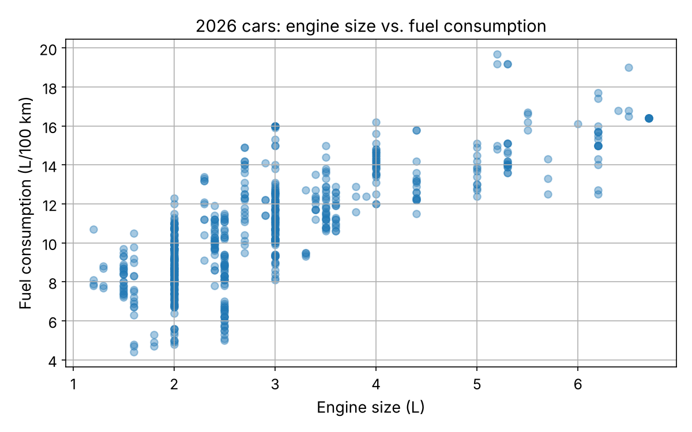
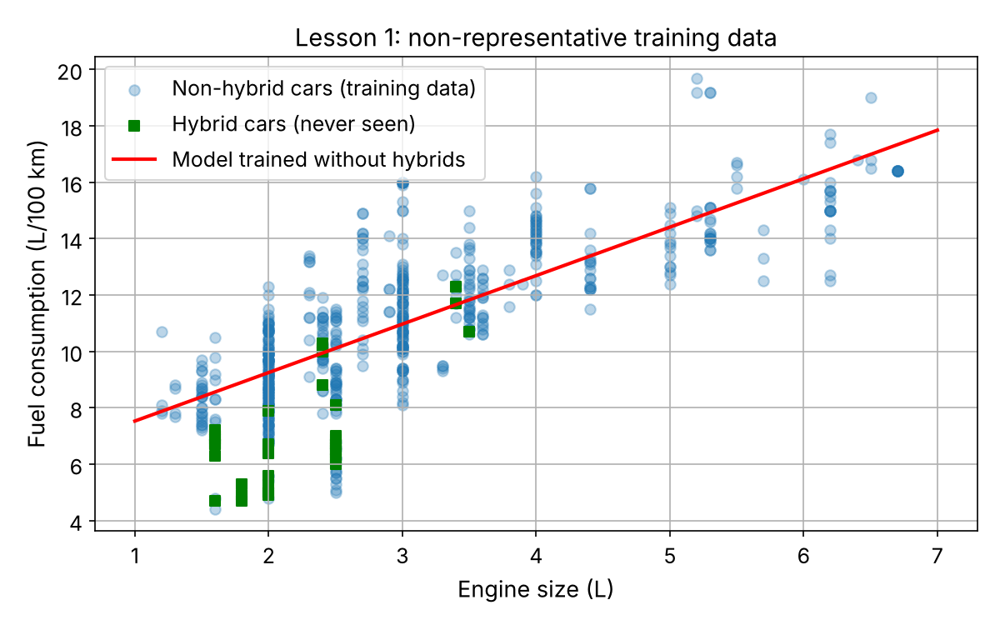
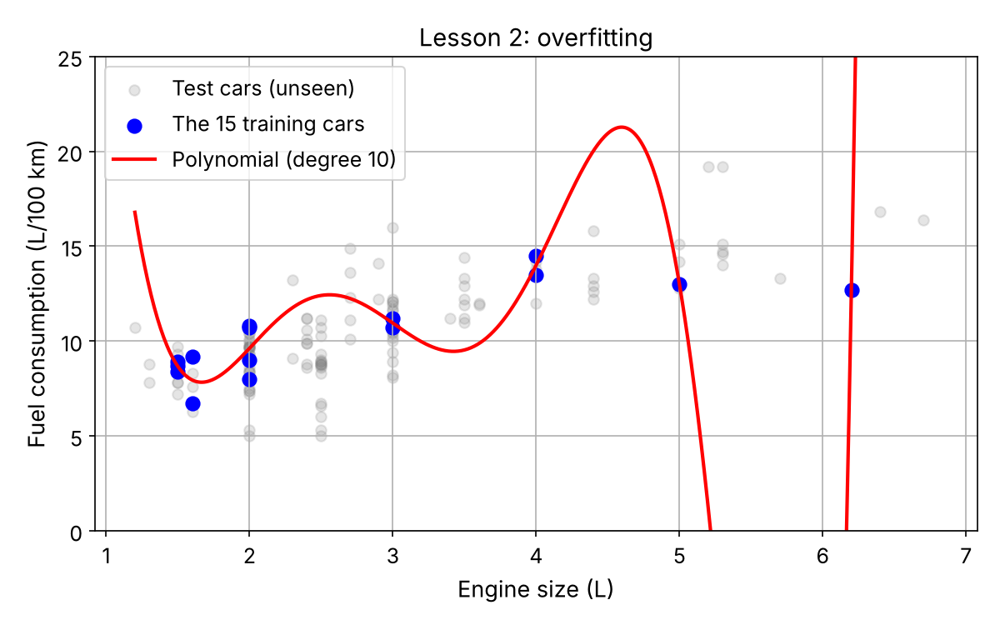
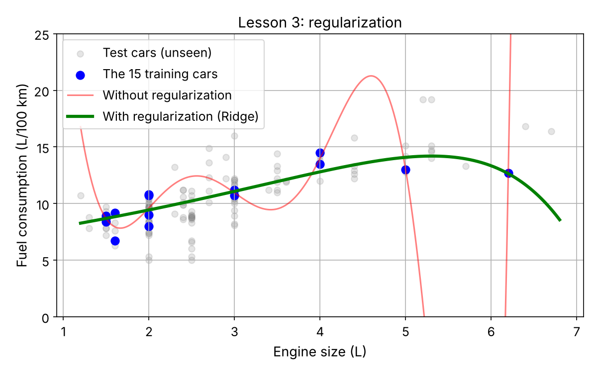

# How Much Fuel Does a Car Need? Predicting Fuel Consumption from Engine Size

**Project 1 of 2** in this repository. It applies the core ideas of Chapter 1 (*The Machine Learning Landscape*) of *Hands-On Machine Learning with Scikit-Learn, Keras & TensorFlow* (3rd ed., Aurélien Géron) to my own question and a current, real-world dataset.

## Question

Can we predict a new car's combined fuel consumption (**L/100 km**) from its engine size alone?



## Data

**Fuel Consumption Ratings, model year 2026** (613 vehicles) and **2015–2024** (10,060 vehicles), published by Natural Resources Canada on the [Government of Canada Open Data portal](https://open.canada.ca/data/en/dataset/98f1a129-f628-4ce4-b24d-6f16bf24dd64).
Licence: [Open Government Licence – Canada](https://open.canada.ca/en/open-government-licence-canada).

The notebook downloads the newest version automatically and falls back to the copy in `data/`.

## What I did

1. Explored the data and the 2015–2026 trend of average consumption
2. Split the data into a training set (80 %) and a test set (20 %)
3. Trained **Linear Regression** (model-based) and **k-Nearest Neighbors** (instance-based)
4. Evaluated both on unseen cars with the **Mean Absolute Error (MAE)**
5. Ran three experiments on core ML concepts

## Results

| Model | Test MAE (L/100 km) |
|---|---|
| Linear Regression | 1.30 |
| k-Nearest Neighbors (k = 5) | 1.18 |

Linear Regression learned that every extra litre of engine size adds about **1.8 L/100 km**.

## Three experiments

**1. Non-representative training data.** A model trained without hybrid cars overestimates hybrids by about 2.5 L/100 km — twice its normal error.



**2. Overfitting.** A degree-10 polynomial trained on only 15 cars: MAE 0.60 on its training cars, but 9.22 on unseen cars.



**3. Regularization.** The same model with Ridge regularization: test MAE drops from 9.22 to 1.42.



## Folder contents

```
car-fuel-consumption-prediction/
├── fuel_consumption_prediction.ipynb   # the full project, step by step
├── data/                               # local copy of the official CSV files
└── images/                             # plots generated by the notebook
```

## How to run

```bash
git clone https://github.com/AT3060/car-fuel-consumption-prediction---life-satisfaction-prediction.git
cd car-fuel-consumption-prediction---life-satisfaction-prediction
pip install -r requirements.txt
cd car-fuel-consumption-prediction
jupyter notebook fuel_consumption_prediction.ipynb
```

## Tools

Python · pandas · NumPy · Matplotlib · Scikit-Learn · Jupyter

## Credits

- Concepts follow Chapter 1 of *Hands-On Machine Learning with Scikit-Learn, Keras & TensorFlow* (3rd ed.) by Aurélien Géron, O'Reilly. The question, dataset, code and experiments in this project are my own.
- Data: Natural Resources Canada, *Fuel consumption ratings*, Open Government Licence – Canada.
