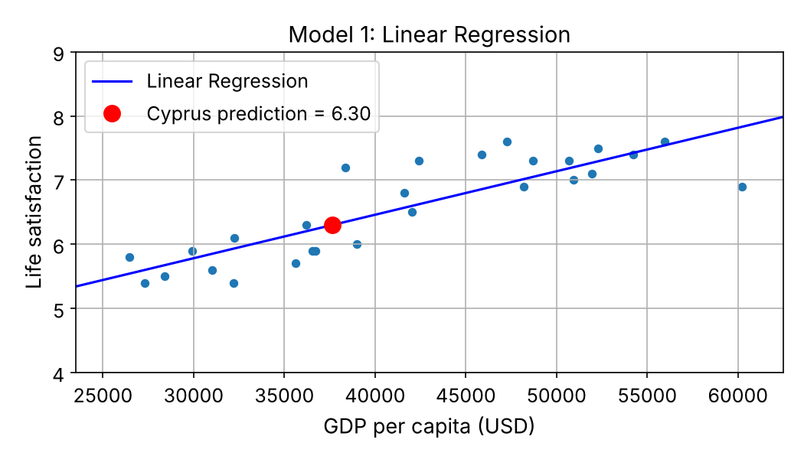
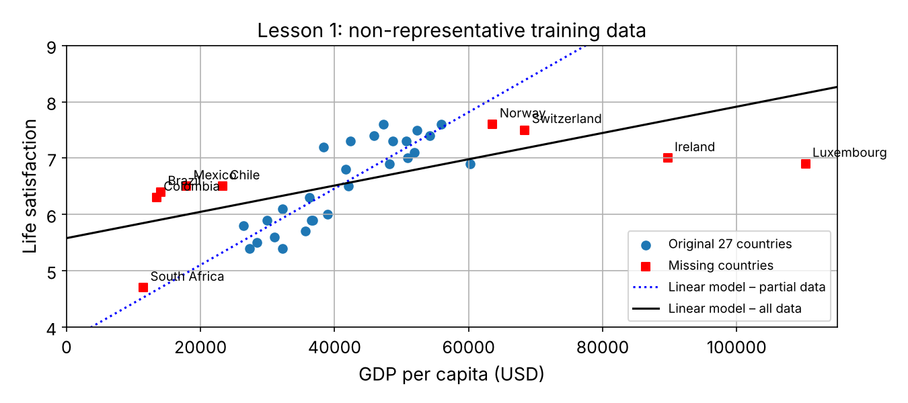
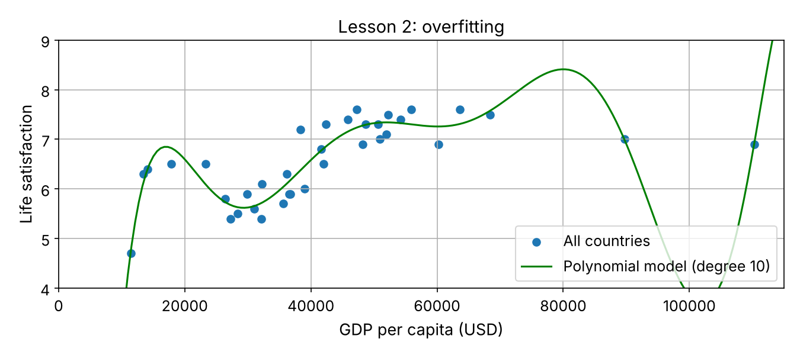
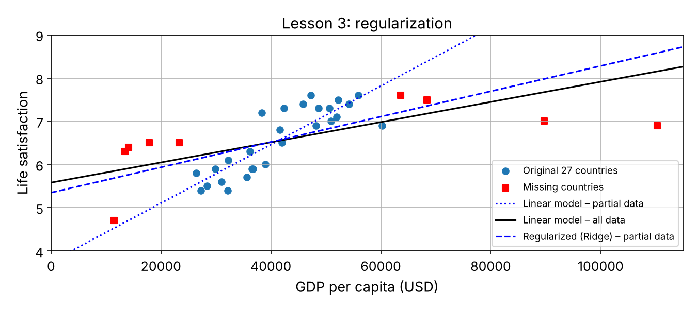

# Does Money Make People Happy? Predicting Life Satisfaction from GDP

**Project 2 of 2** in this repository: a guided, beginner-friendly walkthrough of the introductory example in
*Hands-On Machine Learning with Scikit-Learn, Keras & TensorFlow* (3rd edition, Aurélien Géron) — Chapter 1: *The Machine Learning Landscape*.

## Goal

Can we predict how satisfied people in a country are with their lives, using only the country's GDP per capita?
I train two regression models and use them to predict the life satisfaction of **Cyprus**, a country that is not in the training data.



## Data

| Source | Feature | Year |
|---|---|---|
| OECD Better Life Index | Life satisfaction (0–10) | 2020 |
| World Bank (via Our World in Data) | GDP per capita (USD) | 2020 |

Prepared CSV files from [ageron/data](https://github.com/ageron/data/tree/main/lifesat). The notebook downloads them automatically.

## Results

| Model | Training data | Prediction for Cyprus |
|---|---|---|
| Linear Regression | 27 countries | 6.30 |
| k-Nearest Neighbors (k = 3) | 27 countries | 6.33 |
| Linear Regression | all 36 countries | 6.46 |
| Ridge (regularized) | 27 countries | 6.45 |

## Key lessons

**1. Training data must be representative.** A line fitted only on mid-income countries does not hold for poorer or very rich countries.



**2. Overfitting.** A degree-10 polynomial fits the training points closely but makes unrealistic predictions in between.



**3. Regularization.** Ridge regression keeps the model simpler, so its line moves closer to the one trained on all countries.



## Folder contents

```
life-satisfaction-prediction/
├── life_satisfaction_prediction.ipynb   # the full walkthrough, step by step
└── images/                              # plots generated by the notebook
```

## How to run

```bash
git clone https://github.com/AT3060/car-fuel-consumption-prediction---life-satisfaction-prediction.git
cd car-fuel-consumption-prediction---life-satisfaction-prediction
pip install -r requirements.txt
cd life-satisfaction-prediction
jupyter notebook life_satisfaction_prediction.ipynb
```

## Tools

Python · pandas · NumPy · Matplotlib · Scikit-Learn · Jupyter

## Credits

Based on Chapter 1 of *Hands-On Machine Learning with Scikit-Learn, Keras & TensorFlow* (3rd ed.) by Aurélien Géron, O'Reilly.
The code is adapted from the official book notebooks in [ageron/handson-ml3](https://github.com/ageron/handson-ml3) (Apache License 2.0), restructured and with my own explanations and additions (nearest-neighbour inspection, comparison tables). Data prepared by Aurélien Géron in [ageron/data](https://github.com/ageron/data).
